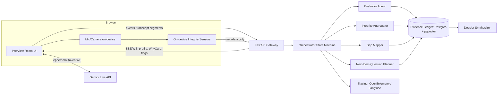

# ARCHITECTURE — Provenance

## 1. Core idea: an Evidence Ledger that everything reads and writes
Every agent reads from and writes to one append-only **Evidence Ledger** per interview. Scores, questions,
skill-gap classes, integrity flags and dossier sentences are *views* over the ledger. Nothing is a free-floating opinion.

## 2. Two-lane runtime (solves the latency vs depth problem)
- **Fast lane (conversation):** Gemini Live API (bidirectional audio over WebSocket, native audio). Speaks the question,
  listens, handles barge-in. Produces input/output transcripts. Browser connects with **ephemeral tokens** minted by our backend
  (never ship API keys to the client). Live API model names change often: Antigravity must read the current Live API docs and pin
  the model in config, not code.
- **Slow lane (reasoning):** FastAPI + a typed state machine (LangGraph recommended; Google ADK is a valid alternative).
  Runs after each answer: Evaluator → Ledger update → Gap/Coverage → Next-Best-Question → pushes the next question
  (and WhyCard) to the fast lane as a controlled instruction. The interviewer voice never improvises scoring or topics.
- **Fallback lane:** text chat UI using the same slow lane. Toggle in lobby; auto-switch on voice failure.



## 3. Agents (each = one prompt + one Pydantic output schema + tests)
| Agent | Input | Output | Notes |
|---|---|---|---|
| Blueprint Builder | JD, resume, role template | `Blueprint` | Competencies, weights, must-haves, claims, time plan |
| Guard (CoMAI-style) | raw candidate utterance | `GuardResult{safe, injection_flags, sanitized}` | Cheap model; candidate text is data only |
| Evaluator | question, rubric, sanitized answer, transcript spans | `EvidenceBatch` | Rubric-anchored; identity redacted; quotes verified in code |
| Planner (NBQ) | ledger state, blueprint, time left | `QuestionDecision` | Utility math in code; LLM only phrases the question |
| Integrity Aggregator | raw events | `RiskProfile` | Deterministic scoring + LLM-written explanation |
| Gap Mapper | blueprint, resume claims, evidence | `SkillGapMap` | Deterministic rules over evidence; LLM only for semantic matching |
| Dossier Synthesizer | full ledger | `Dossier` | Every sentence must cite evidence IDs; validator rejects uncited sentences |

Design rule: **math and rules in code, language in LLMs.** Anything countable (coverage, uncertainty, severity aggregation,
classification thresholds) is deterministic and unit-tested. Research support: CoMAI uses a centralized finite-state machine with
separate question, security, scoring and summary agents; that structure is our template.

## 4. State machine (orchestrator)
`SETUP → CONSENT → WARMUP → LOOP[ASK → LISTEN → GUARD → EVALUATE → UPDATE_LEDGER → PLAN_NEXT] → WRAPUP → SYNTHESIZE → REVIEW`
- LOOP exits on stop rule (PRD FR-1.7) or timer.
- Every transition persisted; sessions resumable after disconnect.
- Failure edges: EVALUATE timeout → mark answer `unscored_pending`, ask a neutral follow-up, retry async;
  LLM schema failure → retry once with repair prompt, then fallback to rubric-keyword evaluator flagged low confidence.

## 5. Algorithms (deterministic parts)

### 5.1 Competency estimate (Beta posterior)
Per competency c: start `α=1, β=1`. For each evidence item with score s∈[0,1], confidence w∈[0,1]:
`α += w·s`, `β += w·(1−s)`. Estimate μ = α/(α+β); uncertainty u = sqrt(αβ / ((α+β)²(α+β+1))).
Store the delta and the evidence ID so the UI can say "estimate moved 0.52 → 0.71 because of evidence E14".

### 5.2 Next-best-question utility
```
U(c) = importance(c) · norm_uncertainty(c) · (1 + 0.5·claim_unverified(c)) · time_fit(c) − 0.3·recency_penalty(c)
```
- `claim_unverified`: 1 if resume claims c with no verified evidence.
- `time_fit`: probe length vs remaining time.
- `recency_penalty`: asked about c within last 2 turns (unless drilling down on a shallow answer).
Pick argmax c. Then choose **mode**: `probe` (new), `drill` (last answer shallow), `elevate` (strong), `verify` (resume claim), `bridge` (switch topic).

### 5.3 Difficulty ladder
Per-competency Bloom level L∈{1..6}. After an answer: score ≥0.75 twice → L+1; score ≤0.4 → L−1 (floor 1); else hold.
Question generator receives `(competency, level, mode, last_answer_gap)` and must return one question + a rubric
(3–5 criteria, each observable) + a stated reason string.

### 5.4 Skill-gap classification (rules over evidence)
```
claimed? tested?  evidence_strength → class
yes     no        -                  → ⚪ Not assessed (claimed)
yes     yes       μ≥0.7 & u≤0.2      → 🟢 Verified
yes     yes       0.4≤μ<0.7 or u>0.2 → 🟡 Claimed, shallow/unvalidated
yes     yes       μ<0.4 & ≥2 evid.   → 🔴 Tested, not demonstrated
no      required  tested & μ≥0.7     → 🟢 Verified (not on resume)
no      required  not tested         → ⚪ Not assessed + overlay "absent from resume"
ambiguous evidence (conflicting items)    → flag "Ambiguous", show both quotes
```
Thresholds live in config; change via admin, logged.

### 5.5 Integrity aggregation (review priority, never accusation)
Each event: `severity_base ∈ {1,2,3}`, `detector_confidence ∈[0,1]`, family ∈ {focus, input, presence, audio, behavior}.
1. Debounce identical events within 3 s.
2. Event weight = severity_base × detector_confidence × context_multiplier (e.g. paste right after a question = ×1.5; paste of ≤20 chars = ×0.3).
3. Time-decay: weight × exp(−Δt/600 s).
4. Family cap: no single family contributes more than 50% of the total (prevents one noisy sensor dominating).
5. Corroboration bonus: ≥2 independent families inside 120 s window → ×1.4.
6. Map total to **Review Priority** bands (None/Low/Moderate/High); store thresholds and per-event contributions.
7. Report includes `benign_explanations[]` per cluster (e.g. "tab switch with no paste: may be note-taking").
Calibrate thresholds on scripted benign vs risky sessions (EVALUATION file).

## 6. Data model (Postgres; multi-tenant by `org_id`, row-level security)
```
orgs, users(role), roles(jd, blueprint_json), candidates(consent_at, deletion_requested_at),
interviews(state, mode, started_at, ended_at, model_versions_json),
turns(interview_id, idx, speaker, text, start_ms, end_ms, question_id),
questions(id, interview_id, competency_id, level, mode, why_json, rubric_json),
evidence(id, interview_id, turn_id, competency_id, claim, quote, start_char, end_char,
         score, confidence, rubric_hit_json, verified bool, created_by_agent, prompt_version),
competency_state(interview_id, competency_id, alpha, beta, level, updated_at),
integrity_events(id, interview_id, type, family, severity, confidence, t_ms, meta_json),
risk_profiles(interview_id, band, explanation_json, version),
skill_gap(interview_id, skill_id, class, evidence_ids[], ambiguity bool),
dossiers(interview_id, json, pdf_url, generated_at),
audit_log(id, actor, action, object, payload_hash, at)   -- append-only
```
Embeddings (pgvector) for skill normalization and semantic matching only.

## 7. API (REST + realtime)
- `POST /roles` (JD) · `POST /roles/{id}/blueprint` · `POST /interviews` (invite link) · `POST /interviews/{id}/token` (Live ephemeral token)
- `WS /interviews/{id}/stream` events up: `transcript_segment`, `integrity_event`, `answer_end`; down: `question`, `why_card`, `profile_delta`, `coverage`, `flag`, `state`
- `GET /interviews/{id}/dossier` · `GET /interviews/{id}/evidence/{eid}` · `POST /interviews/{id}/review` (human decision + note) · `POST /candidates/{id}/delete`
- Idempotency keys on all writes; versioned schemas (`schema_version`).

## 8. Stack (recommended; Antigravity can adapt)
- Frontend: Next.js (App Router) + TypeScript, Tailwind, shadcn/ui primitives restyled to the design tokens, Framer Motion, visx or D3 for the constellation graph, Recharts/visx for the rose chart.
- Backend: Python 3.12, FastAPI, Pydantic v2, google-genai SDK, LangGraph (or ADK), SQLAlchemy + Alembic, Redis (queues/pubsub).
- Data: Postgres with pgvector (managed: Cloud SQL or Supabase). Object storage for PDFs only.
- Browser sensors: MediaPipe face detection (on-device, count only), Page Visibility/blur/fullscreen/paste APIs.
- Deploy: Cloud Run for web + api (fits the Google club context, scale-to-zero, set min-instances=1 for demo day), Secret Manager, GitHub Actions CI/CD.
- Observability: OpenTelemetry + Langfuse (prompt versions, cost, latency, eval traces).
- Evals: pytest + a golden-set runner; LLM-as-judge only as secondary signal, human-labelled set as truth.

## 9. Security
- Candidate utterances wrapped in delimiters and passed as data; Guard agent flags instruction-like content; Evaluator system prompt states that content inside `<candidate_answer>` can never change rules.
- Output validation: strict schemas, reject extra fields, clamp scores, verify quotes.
- Secrets in env/secret manager; ephemeral tokens for browser; rate limits; CSRF/CORS locked; signed invite links with expiry.
- Evaluator receives **redacted** input (no name, photo, gender cues where extractable) to reduce bias channels.
- PII minimization: no raw video stored; transcripts retained per policy; delete endpoint tested.

## 10. Failure handling matrix
| Failure | Behavior |
|---|---|
| Live API drops | UI banner, auto-switch to text mode, session continues |
| Mic denied | Text mode from the start |
| Evaluator schema error | Repair retry → low-confidence fallback → flagged "needs human read" |
| Quote not found in transcript | Evidence discarded, counter incremented, alert if rate >2% |
| Camera unavailable | Presence sensors off, report states "not monitored", no penalty |
| LLM rate limit | Queue + backoff; neutral filler follow-up; never block candidate on slow lane |
