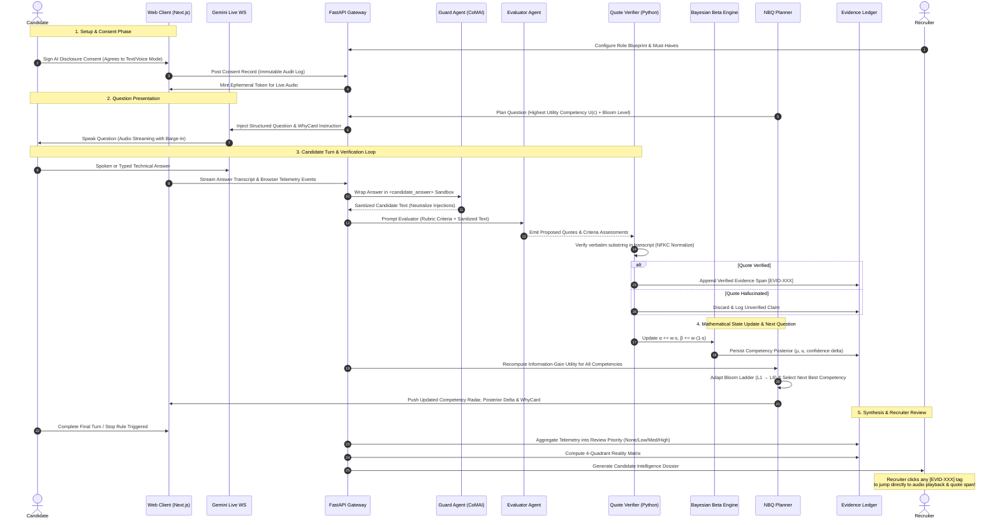

# Provenance — System Workflow & Dataflow Architecture
### Submitted for Google Student Club Welcome Hackathon 2026 — Track 03: Adaptive Interview Intelligence

---

## 1. Executive System Workflow (The 5-Module Pipeline)

*High-Resolution Image Assets: [Download PNG](./provenance_workflow_diagram.png) • [Download JPG](./provenance_workflow_diagram.jpg)*

```mermaid
flowchart TD
    %% Styling Classes (High-contrast & aesthetic on both Dark and Light themes)
    classDef stageHeader fill:#0f172a,stroke:#38bdf8,stroke-width:2px,color:#f8fafc;
    classDef nodeBlue fill:#dbeafe,stroke:#2563eb,stroke-width:1.5px,color:#1e3a8a;
    classDef nodePeach fill:#ffedd5,stroke:#ea580c,stroke-width:1.5px,color:#7c2d12;
    classDef nodeGreen fill:#dcfce7,stroke:#16a34a,stroke-width:1.5px,color:#14532d;
    classDef nodePurple fill:#f3e8ff,stroke:#9333ea,stroke-width:1.5px,color:#581c87;
    classDef nodeRed fill:#fee2e2,stroke:#dc2626,stroke-width:1.5px,color:#7f1d1d;
    classDef nodeCyan fill:#e0f2fe,stroke:#0284c7,stroke-width:1.5px,color:#0369a1;
    classDef decisionDiamond fill:#0f172a,stroke:#cbd5e1,stroke-width:2px,color:#f8fafc;
    classDef databaseNode fill:#1e1b4b,stroke:#818cf8,stroke-width:3px,color:#e0e7ff;
    classDef outputCard fill:#f0f9ff,stroke:#0284c7,stroke-width:2px,color:#0c4a6e;

    subgraph S1 ["1. ROLE CONFIGURATION & ONBOARDING"]
        A1["Select or Upload Job Description<br/>(Role Blueprint & Rubrics)"]:::nodeBlue
        A2["Upload Candidate Resume<br/>(Extract Claimed Competencies)"]:::nodeBlue
        D1{"Select User<br/>Role"}:::decisionDiamond
        A3_Cand["Candidate Track<br/>(Practice & Live Interview)"]:::nodeBlue
        A3_Rec["Recruiter Track<br/>(Calibration & Blueprint Mgmt)"]:::nodeBlue
        A1 --> A2 --> D1
        D1 -->|Candidate Flow| A3_Cand
        D1 -->|Recruiter Flow| A3_Rec
    end

    subgraph S2 ["2. UTILITY-BASED ADAPTIVE PLANNING (MODULE 01)"]
        B1["Information-Gain Utility Engine<br/>U(c) = w · u(c) · (1 + 0.5·claim) - recency"]:::nodePeach
        B2["Evaluate Uncertainty & Resume Claims<br/>Target Highest Diagnostic Value"]:::nodePeach
        B3["Dynamic Bloom Taxonomy Ladder<br/>Adaptive Difficulty L1 (Recall) → L6 (Design)"]:::nodePeach
        D2{"Target Competency<br/>& Bloom Level"}:::decisionDiamond
        B4_1["System Architecture & Scalability<br/>(Distributed Systems, Bloom L5)"]:::nodeGreen
        B4_2["Concurrency & Real-Time Sync<br/>(Thread Safety, Bloom L4)"]:::nodeGreen
        B4_3["Algorithmic Reliability & Trade-offs<br/>(Fault Tolerance, Bloom L3)"]:::nodeGreen

        B1 --> B2 --> B3 --> D2
        D2 -->|Focus A: Architecture| B4_1
        D2 -->|Focus B: Concurrency| B4_2
        D2 -->|Focus C: Reliability| B4_3
    end

    subgraph S3 ["3. LIVE RUNTIME & CoMAI SECURITY SANDBOX"]
        C1["Candidate Submits Technical Response<br/>(Gemini Live WS Audio / Text Fallback)"]:::nodeRed
        C2["CoMAI Prompt-Injection Guard Sandbox<br/>Wrap in &lt;candidate_answer&gt; Delimiters"]:::nodePeach
        D3{"Prompt Injection<br/>Detected?"}:::decisionDiamond
        C3_Block["Quarantine Malicious Input<br/>Neutralize & Log to Audit Trail"]:::nodeRed
        C3_Clean["Forward Sanitized Text<br/>To Evaluator Engine"]:::nodeGreen
        
        DB[("Central Append-Only Evidence Ledger<br/>(SQLite / PostgreSQL + pgvector)")]:::databaseNode

        C_Telem["Client Browser Telemetry<br/>(Focus/Blur, Paste Velocity, WebRTC Presence)"]:::nodePeach
        C_Agg["Integrity Aggregator Engine<br/>(3s Debounce, Exp Decay, 50% Sensor Cap)"]:::nodePeach

        C1 --> C2 --> D3
        D3 -->|Yes: Attack| C3_Block
        D3 -->|No: Safe| C3_Clean
        C_Telem --> C_Agg --> DB
    end

    subgraph S4 ["4. REAL-TIME EVALUATION & QUOTE VERIFIER (MODULE 02)"]
        E1["Rubric-Anchored Evaluator Agent<br/>(Extract Proposed Quotes & Met Criteria)"]:::nodePeach
        D4{"Verbatim Quote<br/>Verified in Code?"}:::decisionDiamond
        E2_Reject["Discard & Purge Claim<br/>(Flag Hallucinated Citation)"]:::nodeRed
        E2_Accept["Append Verified Evidence Span<br/>Mint Immutable Citation [EVID-XXX]"]:::nodeGreen
        E3["Bayesian Beta Engine Update<br/>α += w·s, β += w·(1 - s)"]:::nodePurple
        E4["Calibrate Competency Posterior<br/>Updated Mean μ and Uncertainty u"]:::nodePurple

        E1 --> D4
        D4 -->|No: Hallucinated| E2_Reject
        D4 -->|Yes: Verified| E2_Accept
        E2_Accept --> E3 --> E4
    end

    subgraph S5 ["5. RESUME-TO-INTERVIEW SKILL GAP INTELLIGENCE (MODULE 04)"]
        G1["Cross-Reference Resume Claims<br/>Against Verified Evidence Ledger"]:::nodePurple
        G2["4-Quadrant Reality Matrix Engine<br/>Classify Candidate Competencies"]:::nodePurple
        G3["Generate Matrix Breakdown<br/>• Verified Strengths: Claimed + Proven<br/>• Untested Claims: Claimed, Not Tested<br/>• Hidden Gems: Unclaimed, Proven<br/>• Growth Gaps: Claimed, Unverified"]:::nodePurple

        G1 --> G2 --> G3
    end

    subgraph S6 ["6. RECRUITER DECISION & AUDIT INTELLIGENCE (MODULE 05 & 03)"]
        O1["Click-to-Proof Evidence Dossier<br/>(Strict Citation Enforcer: 0 Uncited Claims)"]:::outputCard
        O2["Interactive Proofline Drawer<br/>(Audio Playback & Verbatim Transcript Spans)"]:::outputCard
        O3["Integrity Review Priority<br/>(None/Low/Med/High + Benign Explanations)"]:::outputCard
        O4["Human Recruiter Decision Studio<br/>(Calibrated Profile & Uncertainty Curves)"]:::outputCard
        O5["Tamper-Evident Audit Trail<br/>(SHA-256 Ledger Hashing & Action Logs)"]:::outputCard
    end

    %% Inter-Stage Pipeline Connections
    A3_Cand --> B1
    A3_Rec -.->|Role Calibration| B1
    B4_1 & B4_2 & B4_3 --> C1

    C3_Clean --> E1
    E2_Accept --> DB
    E4 --> DB
    E4 -.->|Bayesian Feedback Loop: Updates Uncertainty u| B1

    DB --> G1
    G3 --> O1

    %% Direct Ledger Feeds to Output Cards
    DB -->|Verified Spans| O1
    DB -->|Audio Timecodes| O2
    DB -->|Telemetry Score| O3
    DB -->|Competency Profile| O4
    DB -->|Audit Entries| O5
```

<b>Click to expand interactive Mermaid flowchart source code</b>

---

## 2. Turn-by-Turn Adaptive Lifecycle (Sequence Diagram)

This sequence diagram illustrates the exact runtime flow for every single interview turn:

---

## 3. The 5 Modules: Exact Responsibilities & Data Contracts

### Module 01: Question Generation & Interview Adaptation
* **Goal:** Eradicate rigid question scripts. Target competencies with the highest diagnostic value.
* **Core Algorithm ($U(c)$):**
  $$U(c) = \text{importance}(c) \times \text{uncertainty}(c) \times (1 + 0.5 \times \text{claim\_unverified}(c)) \times \text{time\_fit}(c) - 0.3 \times \text{recency\_penalty}(c)$$
* **Adaptive Bloom Ladder:** Automatically escalates or eases technical challenge:
  - 2 consecutive high scores ($\ge 0.75$) $\rightarrow$ Elevate Bloom Level ($L \rightarrow L+1$)
  - Low score ($\le 0.40$) $\rightarrow$ Lower Bloom Level ($L \rightarrow L-1$)
* **Explainability:** Emits a **WhyCard** with each question explaining *why* this competency was selected and *what* observable rubric criteria are being evaluated.

---

### Module 02: Real-Time Candidate Evaluation
* **Goal:** Eliminate subjective, ungrounded scoring. Every evaluation is anchored in verbatim quotes.
* **CoMAI Security Guard:** Candidate answers are treated as untrusted data, enclosed in `<candidate_answer>` delimiters to neutralize prompt injection attacks.
* **Code-Level Quote Verifier (`quote_verifier.py`):**
  - Performs NFKC normalized substring match against the immutable transcript.
  - Rejects, purges, and logs any quote that the candidate did not actually state.
* **Bayesian Conjugate Beta Engine (`beta_engine.py`):**
  - Prior: $\text{Beta}(\alpha=1, \beta=1)$ (Uniform)
  - Posterior update: $\alpha \leftarrow \alpha + w \cdot s$, $\beta \leftarrow \beta + w \cdot (1 - s)$
  - Mean competency estimate: $\mu = \frac{\alpha}{\alpha + \beta}$
  - Calibrated uncertainty: $u = \sqrt{\frac{\alpha \beta}{(\alpha + \beta)^2 (\alpha + \beta + 1)}}$

---

### Module 03: Interview Integrity Intelligence
* **Goal:** Fair play without accusatory black-box proctoring.
* **Privacy Sovereignty:** Zero face recognition, zero emotion analysis, zero raw video storage. Uses on-device WebRTC presence counting only.
* **Contextual Aggregation Engine (`integrity_service.py`):**
  - **3-Second Temporal Debounce:** Prevents sensor flapping.
  - **Exponential Time Decay:** Older events decay via $e^{-\Delta t / 600\text{s}}$.
  - **50% Family Cap:** Prevents single noisy sensors (e.g. erratic window blur) from dominating the signal.
  - **Multi-Source Corroboration:** Multiplier ($1.4\times$) applied only if $\ge 2$ independent sensor families trigger together.
* **Output:** Emits a **Review Priority** (`None`, `Low`, `Medium`, `High`) paired with **Benign Alternatives** (e.g. *"Candidate referenced personal notes or documentation on a secondary display"*). Never outputs "cheating probability"; never auto-rejects.

---

### Module 04: Resume-to-Interview Skill Gap Intelligence
* **Goal:** Distinguish between what a candidate claims on paper vs. what they proved in action.
* **4-Quadrant Reality Matrix:**
  1. **🟢 Verified Strengths:** Claimed on resume **AND** demonstrated in interview ($\mu \ge 0.70, u \le 0.20$).
  2. **🟡 Untested Claims:** Claimed on resume but not evaluated during the interview.
  3. **✨ Hidden Gems:** **NOT** claimed on resume, but discovered and proven during adaptive questioning ($\mu \ge 0.70$).
  4. **🔴 Growth Gaps:** Claimed on resume, but tested and unverified in the interview ($\mu < 0.40$).

---

### Module 05: Candidate Decision Intelligence
* **Goal:** Empower human recruiters with verified evidence rather than an arbitrary single score.
* **Strict Citation Enforcer (`citation_validator.py`):**
  - Every evaluative claim in the executive briefing must cite a valid `[EVID-XXX]` ID.
  - Uncited evaluative sentences fail CI/CD release gates (0 uncited sentences permitted).
* **Click-to-Proof UX:** Clicking any score, badge, or sentence opens the exact audio timestamp and transcript quote span in the Proofline Drawer.
* **Immutable Audit Trail:** All actions (consent, question generation, evidence recording, recruiter decisions) are hashed into the tamper-evident ledger.
